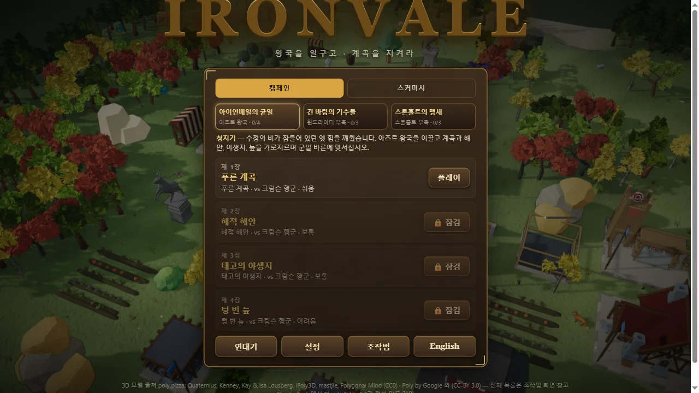
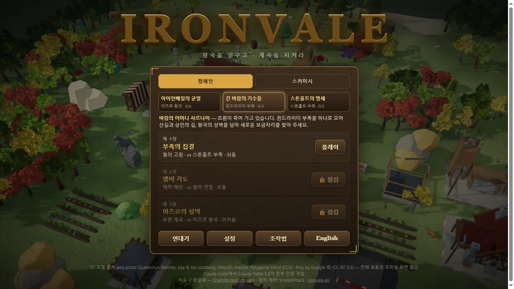
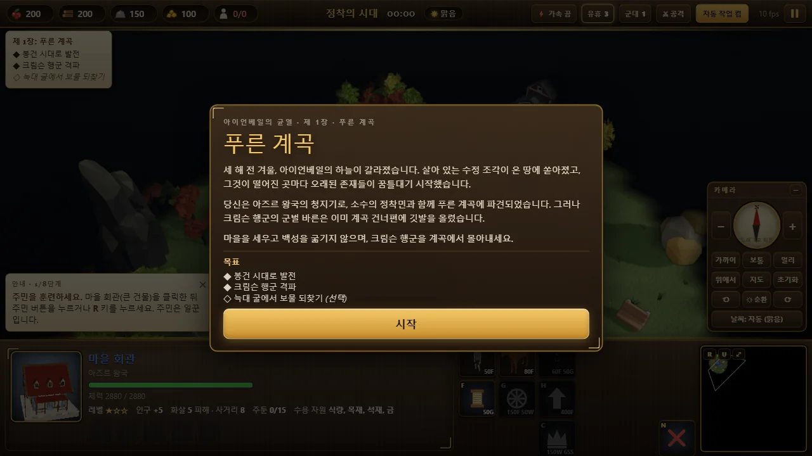
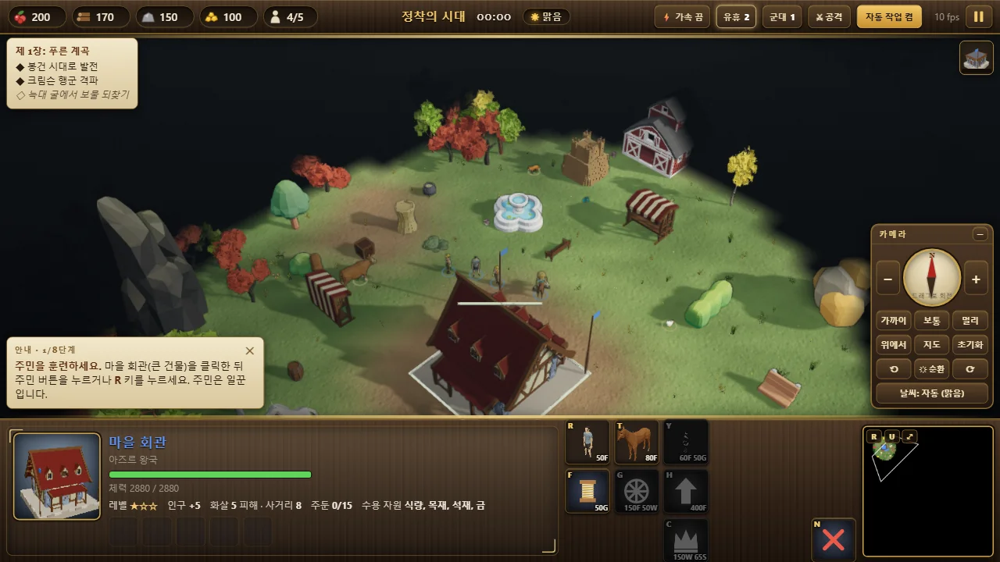
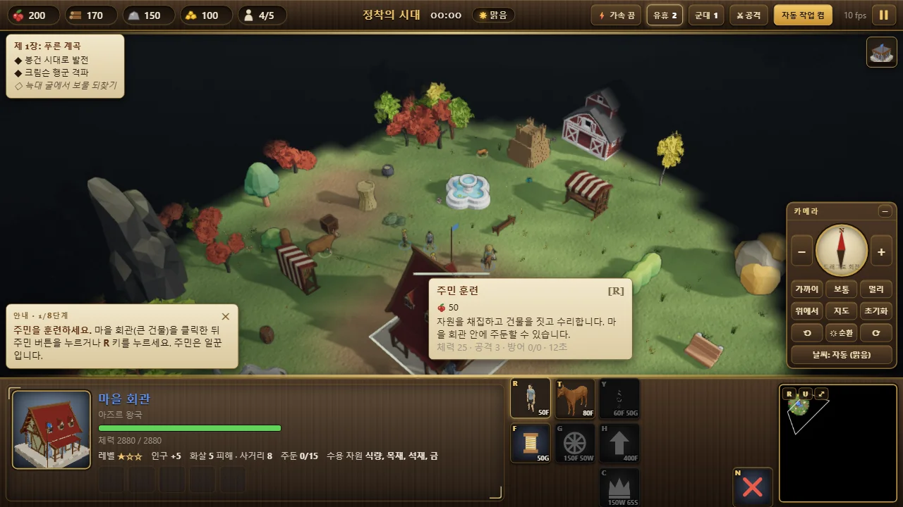
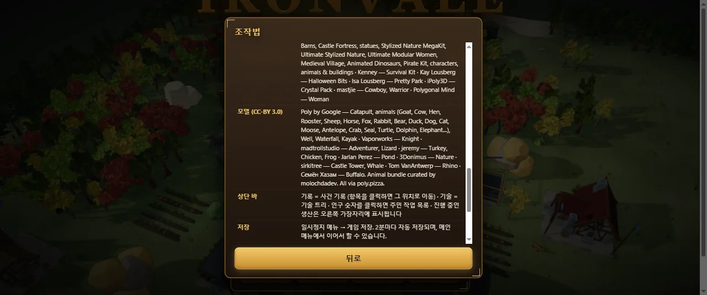

# 아이언베일 한글화 (Ironvale-ko)

**비공식 한글화** — 브라우저용 3D 실시간 전략(AoE 풍) 게임 *Ironvale*의 한국어 버전입니다.

- 플레이: https://sigco3111.github.io/ironvale-ko/
- 원작 플레이: https://sharpwizard.github.io/ironvale/

## 스크린샷

실제 라이브 사이트(https://sigco3111.github.io/ironvale-ko/)에서 캡처한 화면입니다.

*메인 메뉴 — 캠페인 3개 탭과 제1장 '푸른 계곡' 등 장 목록, 하단의 연대기·설정·조작법·English 버튼.*

*캠페인 선택 — '긴 바람의 기수들'을 고른 화면(제1장 부족의 집결, 제2장 앰버 가도, 제3장 아즈르의 성벽).*

*제1장 '푸른 계곡' 브리핑 — 장 소개글과 목표, 시작 버튼.*

*게임 화면 — 상단 자원 막대와 시계, 좌측 목표 창, 하단 정보 패널과 명령 버튼, 우측 카메라 패널과 미니맵.*

*마을 회관을 선택한 정보 패널과 '주민 훈련' 버튼의 한국어 설명 툴팁.*

*조작법 화면 — 3D 모델 크레딧(CC-BY 3.0 포함)과 상단 바·저장 설명.*

## 안내 (NOTICE)

- 원작: **Ironvale** — 제작자 **SharpWizard** (Claude Fable 5.2로 제작) — https://github.com/SharpWizard/ironvale
- 한글화 기준 원작 커밋: `41672ef32a42c154b237e579cdf357144709204a`
- 이 저장소는 원작 제작자와 무관한 **비공식 한글화**이며, 원작의 모든 권리는 원작 제작자에게 있습니다.
- 한글화 시점에 원작 저장소에는 **라이선스 파일이 없습니다.** 이 저장소는 어떤 라이선스도 주장하지 않으며 LICENSE 파일을 두지 않습니다.
- 원작 출처를 밝혀 게시하며, 권리자가 요청하면 **즉시 내리겠습니다.** (이슈로 알려 주세요)
- 3D 모델 크레딧(poly.pizza, CC0 및 CC-BY 3.0)은 원작 그대로 유지합니다. 게임 안 `조작법` 화면에 전체 목록이 있습니다.
  - CC0: Quaternius, Kenney, Kay Lousberg, Isa Lousberg, iPoly3D, mastjie, Polygonal Mind
  - CC-BY 3.0 (저작자 표시 필요): Poly by Google, Vaporworks, madtrollstudio, jeremy, Jarlan Perez, 3Donimus, sirkitree, Tom VanAntwerp, Семён Хазам (동물 번들: molochdadev)
- 메인 메뉴 하단에 한글화 크레딧 문구가 표시됩니다.

## 변경 내역 (원작 대비)

- `src/00_i18n.js`, `src/00_i18n_ko.js` 추가: 한국어/영어 사전과 `t()`, 언어 설정(localStorage `ironvale.lang`, 기본 한국어). 메인 메뉴의 언어 버튼과 설정의 `언어` 항목으로 전환합니다.
- `src/shell.html`: 언어 버튼·설정 행, 한글화 크레딧 문구, 한글 폰트 대체 목록(Pretendard / Noto Sans KR / Apple SD Gothic Neo / Malgun Gothic, 시스템 글꼴만 사용), 한글용 CSS 보정.
- 번역 범위(I1): 메인 메뉴, 설정, HUD 자원·명령 버튼, 조작법 화면, 일시정지, 로딩 문구, 주요 알림.
- 번역 범위(I2): 정보 패널, 카메라 패널, 툴팁, 유닛·건물·기술 설명, 튜토리얼 안내(Guide), 목표 트래커, 저장 슬롯, 기술 트리, 종료 화면. `src/00_i18n_ko2.js`(사전·규칙)와 `tools/check-i18n.js`(번역 누락 검사)가 추가되었고, 표시용 `I18N.t` 호출 몇 곳이 `src/10_ui.js`, `src/15_extras.js`, `src/17_ui2.js`에 들어갔습니다.
- 번역 범위(I3): 캠페인 3개 이름·소개, 장 제목·소개·결말, 진행 중 대사(비트), 연대기, 세력(왕국) 설명·보너스, 지도 테마 설명. `src/00_i18n_ko3.js`(사전·규칙) 추가, 빌드 순서에 자동 포함. 보스 이름 확정: 폭군 / 붉은수염 선장 / 무덤 기사.
- 게임 로직과 모델은 수정하지 않았습니다.

## 빌드

`node build.js` — `src/*.js`를 `src/shell.html`에 합쳐 `ironvale.html`을 만듭니다. `index.html`은 `ironvale.html`로 이동합니다. `models/`, `lib/`는 그대로 함께 두어야 합니다.
